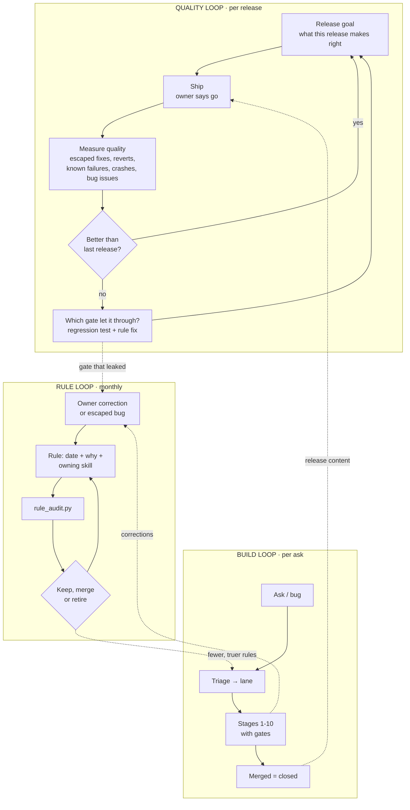
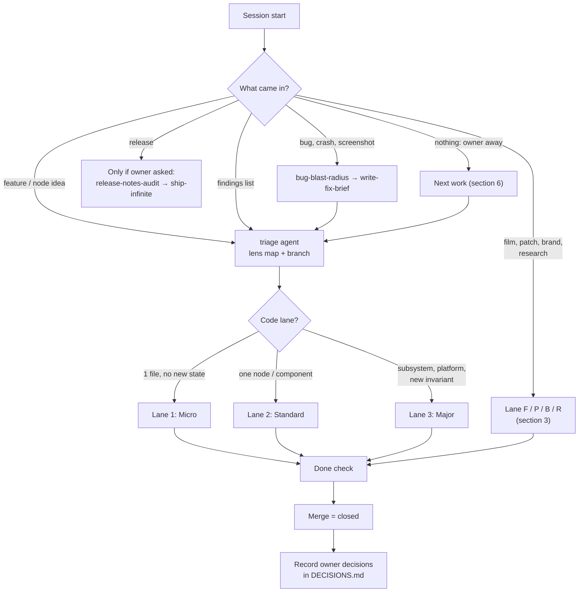
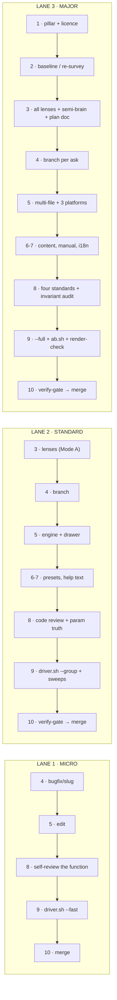
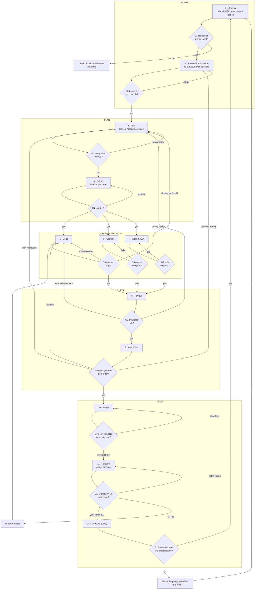
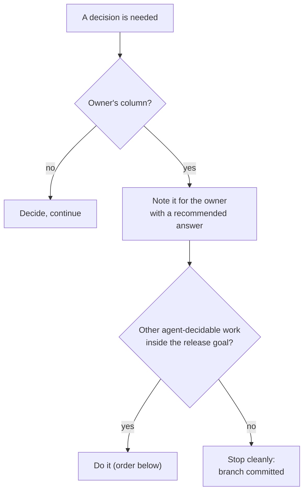
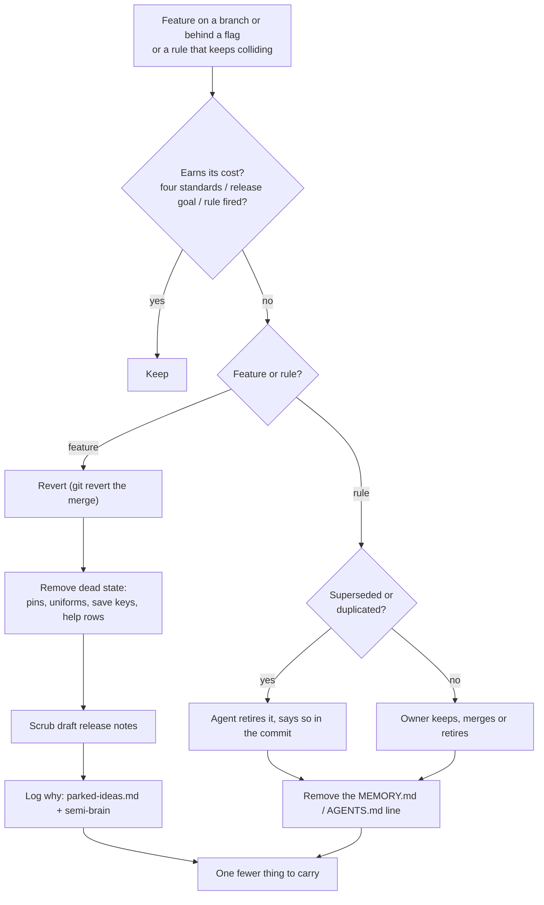

## When to use (full scope)

This is the **process both the owner and the agents follow**, and the map of where every detail
lives. Each box names the skill that owns the detail; open that skill for the how. If this file and
an owning skill disagree on a detail, the owning skill wins and this file gets fixed.

**Use it for every decision, including when the owner is away** (section 6 says how).

Every session, in this order:

1. Read `docs/DECISIONS.md` (the owner's standing decisions) and check `git worktree list` and
   `git branch` so you don't take a branch another session is on.
2. Route the ask (section 2), run its lane (section 3), pass its gates (section 4).
3. On finishing: record any owner decision that matters later in `docs/DECISIONS.md`.

Paths are relative to the repo root.

---

## 1. The bird's-eye view: three loops



| Loop | Question it answers | Cadence | Output |
|---|---|---|---|
| Quality | Is each release more right than the last? | Each release | For every escaped fix, the gate that missed it (section 9) |
| Build | Is this change correct, safe and finished? | Each ask | A merged branch (closed) |
| Rule | Are our rules still true, consistent and worth their words? | Monthly, or when two rules collide | Retired or merged rules |

**The release measure is quality, not downloads.** Downloads, stars and site visits move with
outreach and viral moments, so they say little about a release; they are context
only. A release is judged by what escaped it (owner decision, 2026-10-12).

---

## 2. Entry and routing



| Ask | Go to (in order) |
|---|---|
| Bug, crash, "this looks wrong" | `bug-blast-radius` → `write-fix-brief` → `triage` |
| New node | `triage` → `new-<kind>-node` → `infinite-planner` |
| Field source / preset | `field-language` → `field-pixel-presets` / `field-modifier-presets` |
| Node UI, widget, style | `node-ui-pillars` → `infinite-design-system` (→ `audio-node-ui` for audio) |
| Audio DSP or engine | `audio-pipeline-sweep` + `param-truth-audit` (+ `rhythmic-quantization-standard` for sync) |
| Timeline / arrange | `timeline-arrangement-architecture` |
| Platform code | `windows-parity` + `linux-parity` (+ `prior-art-scout` if the cause is outside our code) |
| Architecture choice | `semi-brain` → `codebase-lenses` → `infinite-planner` |
| Perf | `docs/plans/perf/README.md` → `run-infinite-hygiene` (efficient routes) |
| Patch (.inf) | `infinite-patch-authoring` |
| Film / video | `film-studio` (→ `motion-film` for Infinite films) |
| Brand surface | `docs/brand/BRAND.md` + `tools/brand/brand_lint.py` |
| Competitor study | `docs/plans/re-survey/README.md` |
| Red CI | `ci-failure-triage` |
| Release (owner asked) | `release-notes-audit` → `ship-infinite` |
| Repeating by-hand work | `tool-first` |

---

## 3. Lanes and their done checks

### Code lanes



| Lane | Pick it when | Done when (all true) |
|---|---|---|
| 1 Micro | One file, no new state, no new param, no new invariant | Builds; `driver.sh --fast` passes; diff is only the intended files; merged |
| 2 Standard | One node, preset, panel or component | Lane 1 + `driver.sh --group <area>` and the area's sweep pass; help text and presets in; every new control has a `ParamRef` or a reason; saves and loads; `verify-gate` read |
| 3 Major | Subsystem, platform, threading, new invariant, new file format | Lane 2 + plan doc in `docs/plans/<x>/` closed; baseline A/B shows no regression on touched paths; builds on macOS, Windows, Linux; `invariant-interaction-audit` done |

**Every bug fix, any lane:** adds the regression test that would have caught it, and names in its
commit message which gate should have caught it (feeds the quality loop).

**Moving lanes:** if a Lane 1 fix turns out to need new state, a new param or a second file with
logic, stop and re-enter at Lane 2 stage 3. Never finish a grown task on the smaller lane.

### Non-code lanes

| Lane | Pick it when | Owning skill | Done when |
|---|---|---|---|
| F Film | Video, reel, thumbnail | `film-studio` → `motion-film` / `node-tutorial-film` | Owner signed off the sheets; one master rendered only when asked; intermediates cleaned, sheets kept |
| P Patch | Build or fix an `.inf` | `infinite-patch-authoring` | Patch checks and renders headless; explained in one paragraph |
| B Brand | Website, social, docs surface | `docs/brand/BRAND.md` | `tools/brand/brand_lint.py` passes; values from `brand.json` |
| R Research | Study, survey, explainer | `docs/plans/re-survey/README.md`, research workflow template | Findings in a plan doc with sources; every claim measured or cited; next step settled |

**Not on any lane:** a release. Merged is *closed*; released is *shipped*; only the owner starts a
release.

---

## 4. The build loop: 12 stages, 12 gates



**Rule for every failure arrow:** go back to the stage that *owns* the failure, never further.
A failed test is a code problem (5) unless the test proves the design wrong (3).

| # | Stage | Gate: pass when | On fail, go to | Owning skill / tool |
|---|---|---|---|---|
| 1 | Strategy | Maps to a pillar P1-P8 and to the release goal; no copyleft source read | Park in `parked-ideas.md` | `docs/plans/re-survey/README.md`, AGENTS invariant 1, `BRAND.md` |
| 2 | Research & baseline | Baseline repeats on a quiet machine | Re-run 2 | `run-infinite-hygiene` (efficient routes), `tools/re-survey/` |
| 3 | Plan | Every lens marked Primary / Touched / Clear, coupling rules applied | Re-open 3 | `codebase-lenses`, `codebase-navigation`, `semi-brain`, `infinite-planner` |
| 4 | Set up | One ask per branch, its own worktree | Split the ask | `git-branch-workflow` |
| 5 | Code | Two-object node split kept, `ParamRef`s registered, all three `Platform::` sides | 5; or 3 if the design can't hold | `new-*-node`, `field-*`, `windows-parity`, `linux-parity` |
| 6 | Content | Presets, templates and library build | 6 | `field-*-presets`, `tools/library/`, `tools/templates/` |
| 7 | Docs & i18n | Help text in all four tables, both directions; manual and fonts rebuilt if touched | 7 | `tools/manual/`, `tools/i18n/`, node-help-coverage rule |
| 8 | Review | Four standards met; no later line or sibling undoes the guarantee; knobs do what labels say | 5; or 3 if the design is wrong | `infinite-code-review`, `invariant-interaction-audit`, `param-truth-audit` |
| 9 | Test & perf | Driver tier for the lane passes; goldens match; touched perf paths no worse; known-failure lists didn't grow | 5 (fail), 3 (perf), 2 (baseline drift) | `run-infinite-hygiene`, `tools/render-check.py`, `scripts/bench/ab.sh` |
| 10 | Merge | `verify-gate` read; `git add` explicit paths only; merged to main = **closed** | Clean the diff | `git-branch-workflow`, `verify-gate` |
| 11 | Release | Owner asked; CI green on 3 platforms; notes match code = **shipped** | `ci-failure-triage` → 5; or fix notes | `ship-infinite`, `release-notes-audit` |
| 12 | Measure quality | Every escaped fix has a named leaking gate and a regression test | Rule loop for the leaking gate | section 9, `semi-brain`, memory |

**Bugs are not a stage.** They enter at the front door (section 2), get the nine questions from
`bug-blast-radius`, and run a lane like any other ask.

---

## 5. Operating profiles (what "good" means depends on where it runs)

| Profile | Clock | Priority order | Verified by |
|---|---|---|---|
| Live (stage, concert) | Real time | Audio > projector > canvas > previews | B1 heavy audio, B3 live performance (`docs/plans/perf/README.md`) |
| Studio (building a patch) | Real time, interactive | Audio and canvas > previews and meters > background | B5/B6 node-scaling and canvas benches |
| Offline (export, render) | Transport sample clock, not wall clock | Determinism and sync > quality > speed | `tools/render-check.py`, `tools/determinism-check.py`, `av-sync-sweep`, B10 |

Export quality is never traded for live speed. Stage 3 names the profile(s) a change touches;
stage 9 runs only that profile's checks.

---

## 6. Who decides what, and working while the owner is away

| The agent decides | The owner decides |
|---|---|
| Implementation, naming, file layout | The release goal: what this release makes right |
| Which lane, which skills, which tests | Anything a user sees for the first time (new UI, new behaviour, brand wording) |
| Design choices inside a plan doc (settle them, no open questions) | Releases, pushes, tags |
| Splitting an ask into branches | Spending money, licensed downloads, accounts |
| Fixing a fact in a skill or doc | Retiring a live rule that has no successor |
| Retiring a rule that is provably superseded or duplicated (say so in the commit message) | Deleting work: branches with unmerged commits, assets, media, tags |

**When the owner is away:**



Order for picking next work with no ask: (1) a red gate on main (CI, known-failure growth),
(2) an escaped fix with no regression test, (3) the next item of the approved plan,
(4) a rule-audit item the agent may settle. Never start a new feature unasked.

When the owner is back: **one decision per message**, recommended answer first; an answer that matters later goes
in `docs/DECISIONS.md` so it is never asked again.

**Precedence when two instructions disagree** (highest first):

1. Safety rules, and the owner's instruction in the current chat
2. AGENTS.md core invariants (clean room, bare names, three platforms, brand book)
3. The skill that owns the topic (AGENTS.md table)
4. This lifecycle
5. Memory notes (newer beats older only when it says it supersedes; otherwise it's a conflict for the rule loop)
6. Plan docs and briefs

---

## 7. Several sessions, one repo

Several sessions and worktrees run at once. Before touching anything, run `git worktree list` and
`git branch --sort=-committerdate | head`: don't take a branch or worktree another session holds.
Only one benchmark runs at a time on the bench machine. The two-laptop rules are in AGENTS.md and
`docs/plans/two-laptops/README.md`.

---

## 8. Pruning: features and rules



Real prunings from history, for calibration: Gaussian Splat node (`a764094f`, later
`1a46bca4`), Mod Mixer node (`3344b8d3`), node dropdown chevron (`d8f54bcb`), canvas zoom LOD
collapse (`5daa264b`, later undone), Tabler strokes replaced by our own glyphs (`ce2efd11`).
Not every trial dies: the video decode thread was removed and later reapplied (`db35579d`).

---

## 9. The quality loop in practice

For the latest release against the one before, measure:

| Measure | What it is | Want |
|---|---|---|
| Escaped fixes | Fix commits after the tag that touch `src/` files the release changed: bugs that shipped | 0, and falling release to release |
| Reverts after the tag | Things that shipped and had to come out | 0 |
| Known test failures | Lines in `run-infinite-hygiene/known-test-failures*.txt` | Never grows |
| Bug issues | Open GitHub issues labelled `bug` | 0 |
| Crash reports | `docs/crash-reports/*.ips` since the tag | 0 |

For each escaped fix: find the gate that should have caught it (usually 8 or 9), add the
regression test if the fix didn't, and if the same gate leaks twice, open a rule-loop item for
that gate's skill.

---

## 10. The rule loop in practice

```bash
python3 tools/lifecycle/rule_audit.py --memory ~/.claude/projects/-Users-namansoni-infinte/memory
```

It lists: always-loaded word count, catalogue drift between AGENTS.md and the skills, memories
with no **Why:**, broken `[[links]]`, "supersedes" chains, and the largest and oldest rules. It
does **not** yet measure whether a rule ever fired; the leaking-gate notes from section 9 are the
first real signal of that. Superseded or duplicated rules: the agent retires them. Everything
else: one at a time to the owner. A new rule names its owning skill and the incident behind it,
or it doesn't get written.

---

## 11. Cadence

| When | Agent | Owner |
|---|---|---|
| Session start | Read `docs/DECISIONS.md`, check worktrees and branches | |
| Each ask | Route → lane → done check | Ask, or leave it to section 6 |
| Each merge | Record owner decisions that matter later | |
| Each release | Stage 11 when asked, then stage 12 | Says go; sets the next release goal |
| Monthly | Rule audit; settle what it may | The items brought one at a time |
| Any time | | Tell the agent decisions or user signals |

Architecture diagrams (layers, threads, dataflow, the two-object node) live in
`docs/ARCHITECTURE_FLOWS.md`, not here.
