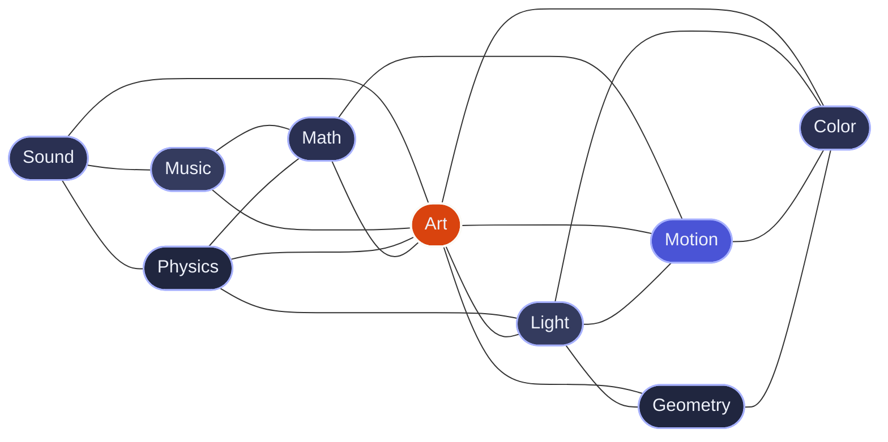

  

  <h1>hi, i'm naman (n1m21n)</h1>

  

    <strong>musician • visual artist • creative technologist</strong>
  

  

    <em>"crafting open-source instruments where sound, art, and geometry connect."</em>
  

  

    
    
    
  

  

    
  

---

### What I'm Building: [Infinite](https://github.com/n1m21n/Infinite)

> **A Free, open-source audiovisual workstation: visuals, music and code on one node canvas, for macOS, Windows and Linux.**
> GPU video and shaders, procedural 3D geometry and physics, and a modular synth rack with AU/VST3 plugin hosting, all patched together through one modulation graph. **Field**, its own language, lets you write what a node does.

**v1.0 (beta) is out**, the biggest release yet. New in 1.0:

- **3D View**: compose node outputs into one scene, look through a camera, render it
- **Terminal**: a real terminal inside the app, and an `infinite` command that drives the open patch, writes and checks code, and renders headless
- **Sample Studio**: record, generate, slice and shape samples, then drop the result on the canvas
- **Session clips, Timeline and Piano Roll**: launch scenes live, record the take into the arrangement, edit notes
- **Mod Matrix and Performance**: every modulation in one table, and a surface of knobs, faders and pads to play the patch
- **New instruments**: physically modelled Piano and Wind, a reworked String, and Generate Samples

  
  

    <a href="https://github.com/n1m21n/Infinite/releases/latest"><strong>Download</strong></a> ·
    <a href="https://infinitedevices.org"><strong>infinitedevices.org</strong></a> ·
    <a href="https://github.com/n1m21n/Infinite#whats-new-in-v10-beta"><strong>What's new</strong></a>
  

---

### Connected by Nature

---

### Contribution Activity

  <picture>
    <source media="(prefers-color-scheme: dark)" srcset="profile-3d-contrib/profile-night-view.svg">
    <source media="(prefers-color-scheme: light)" srcset="profile-3d-contrib/profile-season.svg">
    
  </picture>

---

### Connect

- Discord Community: [Join the Infinite Server](https://discord.gg/GMeQTyJqkH)
- Twitter / X: [@n1m21n](https://x.com/n1m21n)
- Instagram: [@n1m21n](https://instagram.com/n1m21n)
- Email: namansoniii21@gmail.com

  Designed with curiosity and passion for generative sound and computational art.

