# Infinite

<picture>
  <source media="(prefers-color-scheme: dark)" srcset="art/brand/readme/readme-dark.png">
  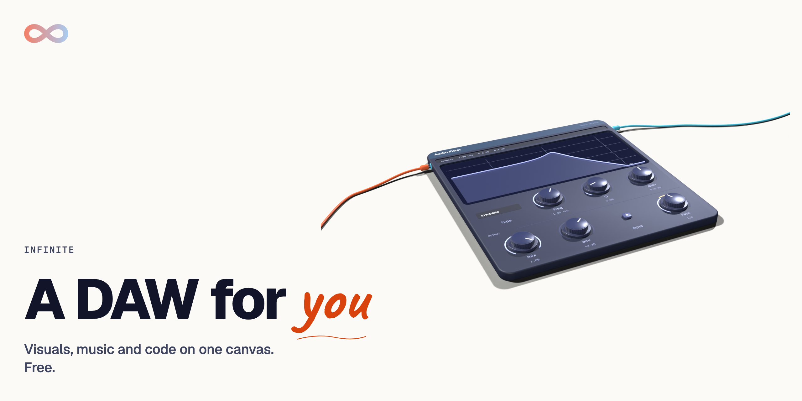
</picture>

[](https://discord.gg/GMeQTyJqkH)
[](https://www.youtube.com/watch?v=vXRjrDhSq24&t=1421s)
[](https://github.com/n1m21n/Infinite)
[](LICENSE)
[](https://trendshift.io/repositories/187223?utm_source=trendshift-badge&utm_medium=badge&utm_campaign=badge-trendshift-187223)

**Infinite is a Free, open-source audiovisual workstation made by Naman Soni (n1m21n).** Visuals, music and code live on one node canvas, on **macOS**, **Windows** and **Linux**, in English, Spanish, German, Chinese, Japanese and Russian. GPU image and video compositing, procedural 3D geometry and physics, and a modular synth rack with AU and VST3 plugin hosting all patch into each other through one modulation graph. Most nodes do one fixed thing; **Field**, Infinite's own programming language, lets you write what a node does instead.

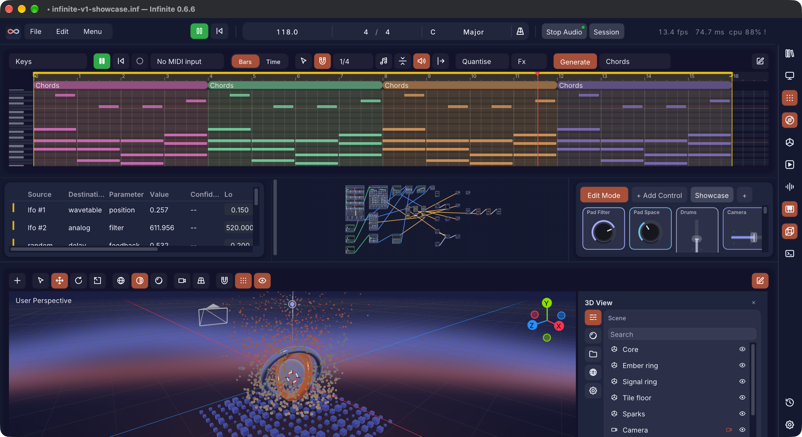

---

## Download

[](https://github.com/n1m21n/Infinite/releases/latest/download/Infinite.dmg) [](https://github.com/n1m21n/Infinite/releases/latest/download/Infinite-windows-x64.zip) [](https://github.com/n1m21n/Infinite/releases/latest/download/Infinite-windows-ARM64.zip) [](https://github.com/n1m21n/Infinite/releases/latest/download/Infinite-x86_64.AppImage)

Always the newest release. All files, checksums and release notes are on the [Releases page](https://github.com/n1m21n/Infinite/releases/latest). First-launch steps for each platform are under [Installation](#installation).

---

## Start here

New to Infinite? Watch the full walkthrough on YouTube: **[Infinite video walkthrough and tutorial](https://www.youtube.com/watch?v=vXRjrDhSq24&t=1421s)**.

### Templates and the Showcase

Start from a working patch instead of an empty canvas. 15 **Starters** each teach one idea in 3 to 6 nodes with Comment notes beside them (first sound, first image, music to image, notes, synths, effects, 3D, modulators, Field and more), and the **Showcase** is a full piece that plays on its own: sound, picture, arrangement, Session scenes and a Performance page, with its media bundled. Open the Templates window from the menu; the Showcase is listed first.

---

## Nodes

### The node canvas

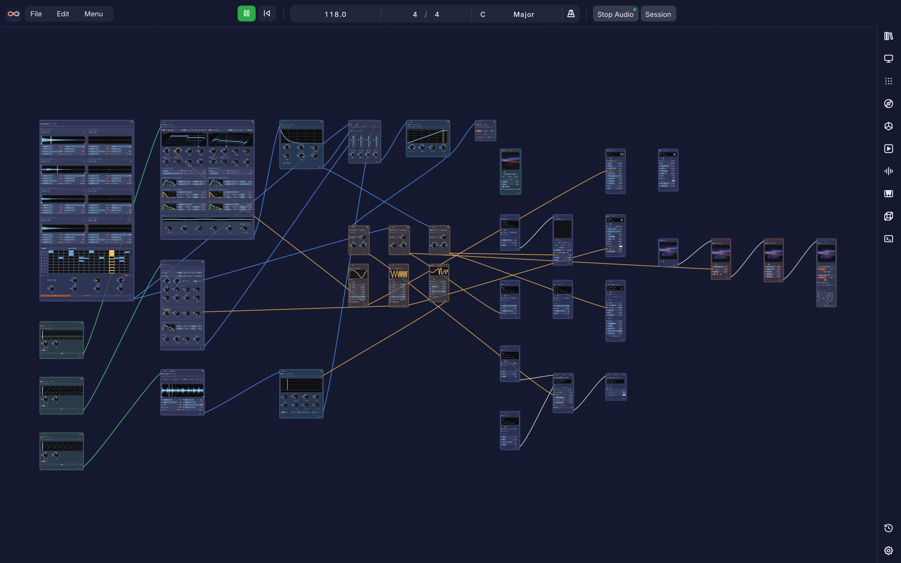

Everything is a node, and every cable carries one kind of thing: pictures, 3D geometry, audio, notes or control signals. Patch left to right, right-click to add, and anything with a dot beside it can be modulated. Infinite has **347 node types**; the [Node library](#node-library) lists them by domain, and the [Node Reference Manual](Infinite_Node_Reference_Manual.pdf) documents each one.

### Pictures and video

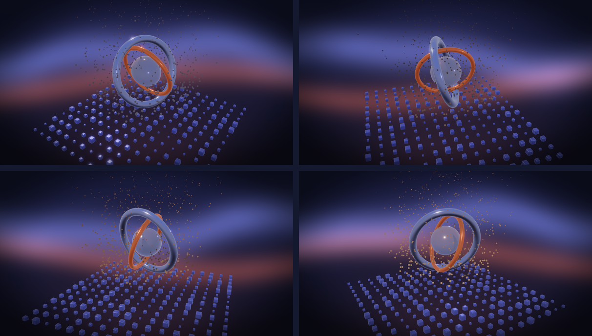

A GPU texture pipeline (GLSL, OpenGL 3.2 Core): images, video and camera, Syphon, Spout and NDI sources, shapes, noise and Field Pixel shaders, 32 blend modes, blur, bloom, glitch, halftone, curves, LUTs, reaction-diffusion, feedback loops and on-device background removal. The frames above are four seconds of the bundled Showcase patch, rendered headless.

### 3D

Procedural meshes, imports (USD, OBJ, PLY, STL, glTF), booleans, Voronoi and Delaunay, instancing on points, particles, PBD cloth and soft bodies, metaballs, Camera and Light nodes, and PBR rendering (Cook-Torrance GGX, ACES, 32-bit HDRI). The [3D View panel](#3d-view) composes them into one scene.

### Sound

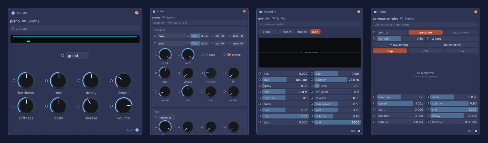

A sample-accurate, pull-based audio graph on the same BPM transport as the pictures. Synths and physical models (Analog, FM, Wavetable, Metallic, String, **Piano**, **Wind**, Granular, PaulStretch, Molder, Sampler, Slicer, 8-track Drum Sequencer, Looper), a full effects rack, AU and VST3 plugin hosting with native windows and modulatable parameters, and **Generate Samples**, a player whose sample is made rather than loaded: pick a part (drums, bass, pads, plucks, leads and more, 18 in all), press generate, and a loop of 1, 2, 4 or 8 bars is rendered from Infinite's own instruments. It saves as a recipe, not as audio.

### Notes and control

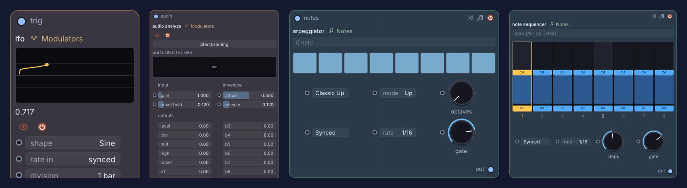

Note sequencers, arpeggiator, chorder, quantizer and MIDI in and out on one side; LFOs, envelopes, random, pattern CV, audio analysis (8-band FFT, onsets), image analysis and camera tracking on the other. Any source can drive any parameter: a shader control, a 3D transform, a synth knob or a hosted plugin's parameter.

### Node library

Infinite has **347 node types**:

| Domain | Key nodes |
|---|---|
| **2D and video** | Image, folder Slideshow, Video (hardware-accelerated), Syphon In / Spout In, NDI In, Paint/Draw canvas, GLSL Formula editor, Sketch (JavaScript-drawn images, with SVG animation), Shapes (SDF), Noise and Gradient Ramps |
| **2D FX and grading** | Blur, Bloom, Glitch (6 modes), Twirl, Ripple, Displace, Halftone, Curves (RGB/Luma splines), Dither, Color Ramp, .cube LUTs, Gradient Map, Palette extraction |
| **Compositing and masks** | Blend (32 modes), Layer Stack, Remove Background (on-device ML segmentation), Chroma/Luma Key, Feedback loop, Reaction-Diffusion, Resynthesize |
| **3D geometry and FX** | Primitives, USD/OBJ/PLY/STL/glTF/GLB import, 3D Text, 3D Curves, Point Distribution, Sketch 3D (JavaScript-built meshes), Mesh Deconstruction, Delaunay Mesh, Voronoi Cells, Decimate, Curve Ops, Taubin Smooth, Array, Instancing, Metaballs, Point Trails |
| **3D scene and render** | 3D View, Camera (orbit/perspective/ortho), Lights, 32-bit HDRI Environment, PBR Materials, ACES tonemapping, multisampled antialiasing |
| **Synths and sound** | Wavetable, Metallic modal resonator, String, Piano, Wind, Generate Samples, Granular, PaulStretch, Molder / Grain Molder (spectral resynthesis), Sampler, Slicer (onset-detecting sample chopper), 8-track Drum Sequencer, 16-pad MPC sampler, Looper (record and overdub, tempo-synced, latency-compensated), multi-waveform Oscillator |
| **Field language** | Field Modifier, Field Primitive, Field Effect, Field Synth, Field Pixel, Field Notes, Field Graph (see [below](#field-and-code)) |
| **Notes and MIDI** | Piano Roll, live MIDI input and clock, Arpeggiator, Note Sequencer, Chorder, Strum, Bouncing Balls (physics notes), Humanizer, Quantizer, MIDI File player, MIDI Out (hardware and virtual ports, CC and clock) |
| **Audio FX and plugins** | **AU / VST3 Plugin Host**, Filters, EQ, Dynamics, Lookahead Limiter, Delay, Reverb, Drive/Saturation, Pitch and Frequency Shifters, Chorus, Phaser, Formant |
| **Modulators and analysis** | LFO, Random, Pattern CV, Envelope Follower, Math, XY Pad, Audio Analyze (8-band FFT, onset), Image Analyze (luminance, motion), Hand / Face / Pose Track (camera to modulators, via the Tracking pack) |
| **Output and I/O** | Spatial Mixer (3D headphone mix with head tracking), PNG snapshot, H.264/MOV recording with synchronised audio, Syphon Out / Spout Out, NDI Out |

---

## Panels

Panels dock to the edges of the node canvas and open from the rail or a key; every shortcut is listed under [Manuals and shortcuts](#manuals-and-shortcuts).

### 3D View

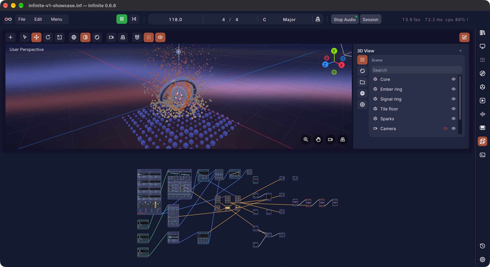

The final stage of a 3D patch (Shift + 3). Right-click a 3D node, add it to the view, arrange the objects, look through a camera and render a still or an animation (seconds and frame rate). The world is a colour or an HDRI, each object picks which lights reach it, and the panel follows Blender's keymap and setting names, with depth of field, ambient occlusion, bloom, composition guides and safe areas. It composes; it does not model, so geometry, materials and simulation stay in the node chain.

### Sample Studio

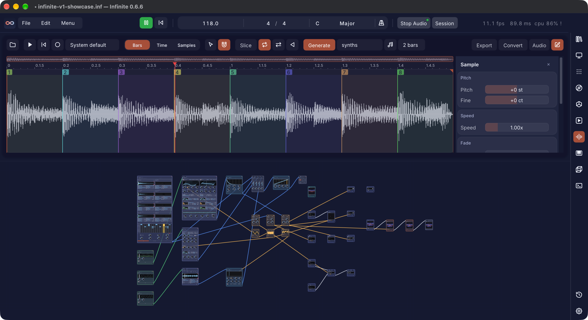

A self-contained sample editor (Shift + W). Open a file, drop one in, record from the audio input, or generate a take. Zoom the waveform, cut it into slices by transients, grid or equal parts, and give each slice its own gain, pan, pitch, fine tune, stretch, fades, shape, colour, mute and solo. Editing never touches the canvas. When it sounds right, Convert puts it on the canvas as a node that plays it (a generated take can also come back as the patch that made it); Export writes the whole edit or each slice to WAV, FLAC or MP3. Studio work is saved in the patch.

### Piano Roll

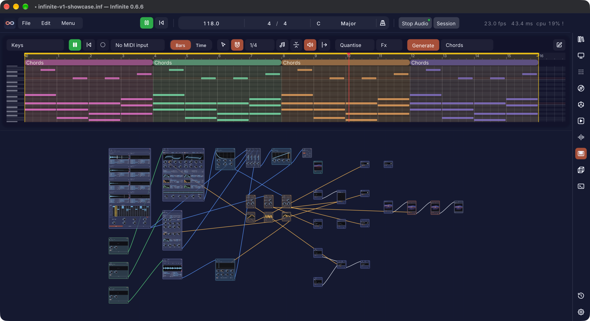

A note editor (Shift + R) for MIDI lanes on the Timeline, played by the Piano Roll node. Draw, erase, select and quantise notes, snap to the project's scale (in-scale lanes are coloured), and transform them with Humanize, Strum, Legato, Chop to Grid, Velocity Ramp, Reverse, Invert and half or double speed. Record from a MIDI input, import a `.mid` file, or press Generate (G) to write notes in the page's key.

### Session and Timeline

| Session | Timeline |
|---|---|
| 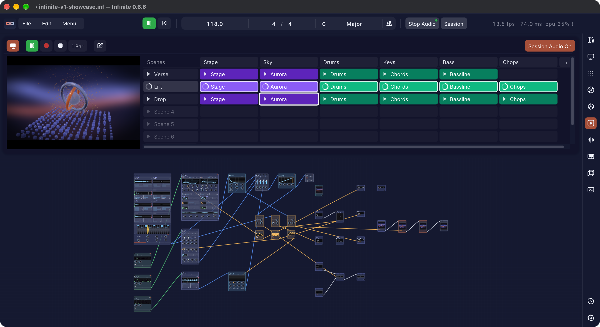 | 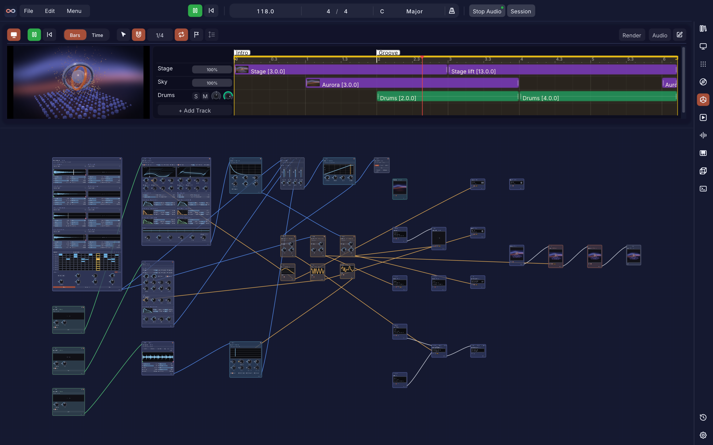 |
| A clip launcher for live sets (Shift + S): audio and video clips in scenes, launch quantize (1 bar by default), Trigger and Gate launch modes, follow actions and "Then Play Next Scene". Record writes your performance into the Timeline, and Render Take renders that span, audio and video, to a folder. | The arrangement (Shift + T): clips on tracks against the same BPM transport, a blade tool, track groups, markers, loop and snap, drag-and-drop media import, live waveforms and video thumbnails, and a render queue. |

### Mod Matrix and Performance

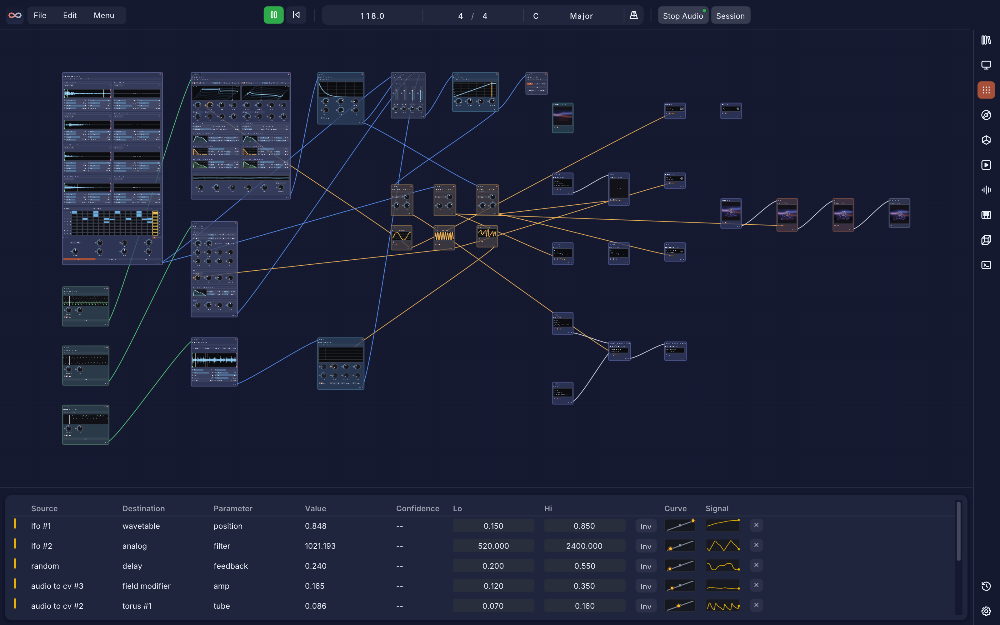

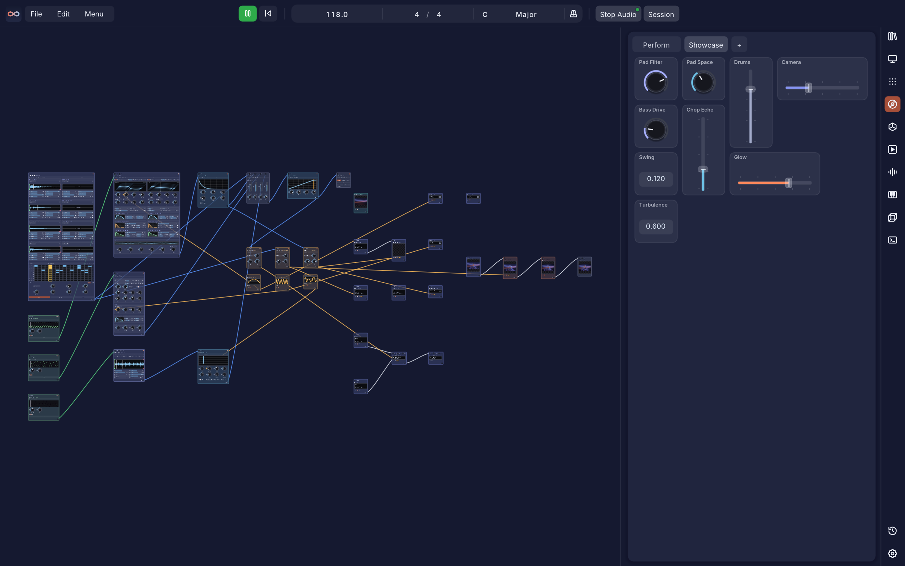

The Mod Matrix (Shift + M) lists every modulation in the patch in one table: source, destination, range, curve and invert, with each source's live signal. The Performance panel (Shift + P) is a surface for playing a patch: pages of knobs, faders, XY pads, toggles, triggers, radio selectors and step gates, each assigned to any parameter, with MIDI learn and a response curve per control. Edit mode lays it out; Perform mode plays it.

### Terminal and the `infinite` command

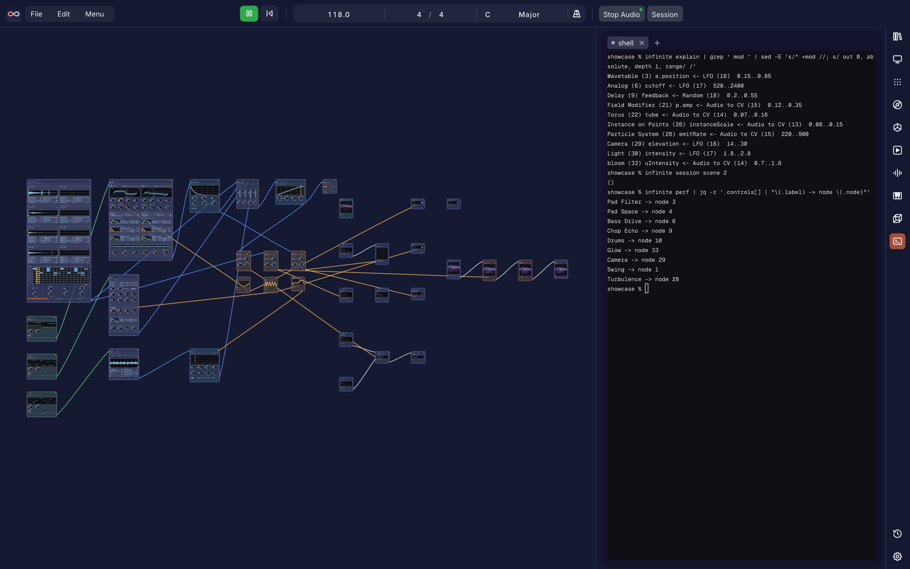

A real terminal inside Infinite (Ctrl + \`), docked on any side, running your own shell and your own tools, coding agents included. No agent ships with Infinite.

Its `infinite` command drives the open patch; see [Headless, CLI and agents](#headless-cli-and-agents).

---

## Plugins and connections

Infinite plays with the rest of your setup:

- **AU and VST3 plugin hosting**: Audio Unit (macOS) and VST3 (macOS, Windows, Linux), with native plugin windows and modulatable parameters. Scan controls and the list of scanned plugins live in Settings > Plugins.
- **MIDI and OSC**: live MIDI input and clock, MIDI Out to hardware and virtual ports (notes, CC, clock), MIDI learn on every Performance control, and OSC Send and Receive nodes.
- **Video to other apps**: Syphon (macOS) and Spout (Windows) zero-copy video in and out, and NDI in and out (needs the free NDI runtime).
- **Files**: PNG snapshots, H.264/MOV recording with synchronised audio, WAV, FLAC and MP3 export, `.mid` import, and USD, OBJ, PLY, STL and glTF models.

---

## Field and code

Every other node in Infinite does one fixed thing: a Blur node blurs, a Delay node delays. **Field** nodes are different. You write a short kernel, and Field works out where it runs from what the code touches.

```
col = vec3(uv.x, uv.y, 0.5)              // once per pixel, on the GPU: a shader
P.y += sin(P.x * 4.0 + t) * 0.2          // once per point in a mesh: a geometry deformer
out = in * gain                          // once per audio sample: a DSP effect
```

That is the one idea underneath the language: a **kernel**, run once per element of a **domain**, forever. You never declare where it runs; the domain, and so the backend it compiles to, is inferred.

| Node | Domain | What it does |
|---|---|---|
| **Field Modifier** | element | Per-vertex kernel over existing geometry: modifies `P`, `N`, `uv`, `Cd` and custom attributes |
| **Field Primitive** | element | Generates point geometry from scratch (Circle, Spiral, Grid Lattice, Fibonacci Sphere, Helix, Torus Knot) |
| **Field Effect** | sample | Per-sample audio DSP kernel; `in`/`out`, `state` for per-voice memory, `param` for knobs |
| **Field Synth** | sample | Polyphonic note-driven synth voice on the same sample compiler, with `freq`/`gate` in place of an audio input |
| **Field Pixel** | pixel | Per-pixel kernel compiled straight to GLSL; `state` cells with `[wrap]` support feedback and stencils |
| **Field Notes** | sample | Per-sample note kernel: `note(pitch, vel, len)` sends notes out, and `tick(div)`, `deg(d)`, `rand()` and `beat` read the transport |
| **Field Graph** | graph | Runs once at edit time: `emit()`/`connect()`/`set()`/`place()` mount and wire real Infinite nodes into a bundle ("Instrument Mode" collapses it to one box; "Unpack to Canvas" expands it again) |

Any element, pixel or sample kernel can declare **dynamic pins** in its code, adding real, cable-wireable, save-safe inputs and outputs without touching C++. Finished devices (kernel, params and presets) save and share as portable `.field` files. The full reference is in the [Field Language Manual](Field_Language_Manual.pdf).

<p align="center">
  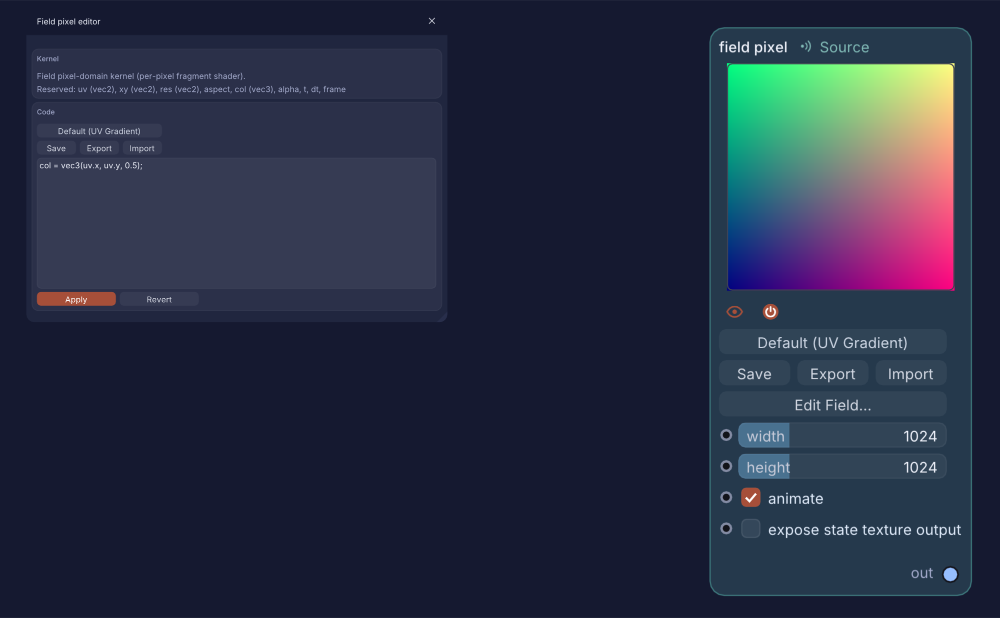
</p>


Field is not the only way to write code in Infinite. **Sketch** draws images with JavaScript (with SVG animation), **Sketch 3D** builds meshes with JavaScript, the **GLSL Formula** node is a live shader editor, and **expressions** (`infinite expr`) drive any parameter from a formula. `infinite code new | check | watch | docs | examples` writes and checks all of them against the real compilers.

---

## Headless, CLI and agents

Infinite also runs with no window: pictures, video and sound straight from a `.inf` text file on the command line, the same engine the `infinite` command uses. See the [Headless User Guide](docs/headless/Infinite_Headless_User_Guide.pdf) ([Markdown](docs/headless/GUIDE.md)).

```bash
Infinite --validate hello.inf                                   # check a patch
Infinite --frame hello.inf 0,1,2 pics/ --contact-sheet sheet.png  # pictures at chosen seconds
Infinite --render hello.inf hello.mp4 --duration 4 --fps 30     # video with sound
```

### The `infinite` command

Inside the Terminal panel (Ctrl + `), or from any shell, `infinite` drives the open patch:

```bash
infinite graph                      # look: the nodes and cables of the open patch
infinite add Analog                 # edit: add, connect, set, mod, expr, undo
infinite connect 1 2                # wire node 1 into node 2
infinite mod 3 2 volume             # modulate node 2's volume from node 3
infinite play                       # play: also tempo, seek, session, timeline
infinite shot selected node.png     # see and hear: shot, frame, render, audio
infinite code docs field            # code: new, check, watch, docs, examples for Field, Sketch, GLSL, formulas
```

With no app running, every verb that takes a `.inf` file runs headless. `infinite context` prints a short brief of the open patch and `infinite guide` the full reference.

### Agents and MCP

For AI coding assistants there is an MCP server, [`tools/npm/infinite-engine`](tools/npm/infinite-engine) (npm: `infinite-engine`), and a Claude plugin described in [`tools/mcp/README.md`](tools/mcp/README.md).

```bash
# Add Infinite to Claude Desktop, Cursor and Windsurf:
npx -y infinite-engine init

# Or through the Smithery registry:
npx -y @smithery/cli install infinite-engine --client claude
npx -y @smithery/cli install infinite-engine --client cursor
```

| MCP tool | What it does |
|---|---|
| `infinite_synthesize_field_synth` | Renders WAV audio from an inline Field Synth kernel |
| `infinite_synthesize_field_notes` | Renders algorithmic note sequences and Euclidean rhythms from a Field Notes kernel |
| `infinite_process_field_effect` | Processes audio through an inline Field Effect kernel |
| `infinite_render_field_pixel` | Renders a Field Pixel shader to a PNG |
| `infinite_render_field_primitive` | Renders parametric surfaces from Field Primitive equations |
| `infinite_render_field_modifier` | Deforms a mesh with an inline Field Modifier kernel |
| `infinite_render_sketch3d` | Renders JavaScript-built 3D geometry to a PNG |
| `infinite_validate_patch` | Checks a `.inf` patch against the engine |
| `infinite_render_video` | Renders an MP4 from a `.inf` patch |

Tool schemas and prompts: [`tools/npm/infinite-engine/README.md`](tools/npm/infinite-engine/README.md) and [`AGENT.md`](AGENT.md).

### AI skill files

Infinite ships reference files you can hand to any AI assistant, or drop into `~/.claude/skills/`, so it writes correct patches and code first time. Settings > Terminal installs all three at once (**Install All AI Skills**) or the patch authoring file alone; the Field Language and Expression Globals pages each have an **Install AI Skill** button for their own file. In the Terminal, `infinite guide` and `infinite code docs <language>` print the same references.

---

## Manuals and shortcuts

| Manual | What it covers |
|---|---|
| [Node Reference Manual](Infinite_Node_Reference_Manual.pdf) | Every node, with its pins and parameters |
| [Field Language Manual](Field_Language_Manual.pdf) | Syntax, domains, domain-transfer operators, reserved words, the node and file format reference |
| [Headless User Guide](docs/headless/Infinite_Headless_User_Guide.pdf) | Rendering and checking patches from the command line |

Every keyboard shortcut is listed in the app under **All shortcuts...** in the menu. The panels:

| Key | Panel |
|---|---|
| Shift + T | Timeline |
| Shift + S | Session |
| Shift + R | Piano Roll |
| Shift + W | Sample Studio |
| Shift + M | Mod Matrix |
| Shift + P | Performance |
| Shift + 3 | 3D View |
| Shift + U | History |
| Ctrl + \` | Terminal |

---

## Installation

### Pre-built app (macOS, Windows and Linux)
Download the latest build from [GitHub Releases](https://github.com/n1m21n/Infinite/releases): `Infinite.dmg` for macOS, `Infinite-windows-x64.zip` / `Infinite-windows-ARM64.zip` for Windows, or `Infinite-x86_64.AppImage` for Linux.

**macOS** (Infinite is not notarised by Apple, so the first launch needs one extra step)

With Homebrew: `brew install --cask n1m21n/tap/infinite` (the first-launch step below still applies).

1. Open the DMG and drag `Infinite.app` to Applications.
2. Double-click `Fix & Open Infinite.command` in the DMG and press `y`. It clears the download flag on Infinite only, then opens it.
   - Or by hand: try to open Infinite once, then **System Settings > Privacy & Security > Open Anyway** (macOS 15 and later), or right-click `Infinite.app` > **Open** (older macOS).
   - Or in Terminal: `xattr -dr com.apple.quarantine /Applications/Infinite.app`

**Windows**
1. Unzip the `x64` or `ARM64` build for your CPU.
2. Run `Infinite.exe`. The build is not code-signed, so Windows SmartScreen may say "Windows protected your PC": click **More info**, then **Run anyway**. It asks once per download.

**Linux**
1. `chmod +x Infinite-x86_64.AppImage`
2. Run `./Infinite-x86_64.AppImage`. It bundles the static AppImage runtime, so no `libfuse2` install is needed. In a container or on a system with no `/dev/fuse`, use `./Infinite-x86_64.AppImage --appimage-extract-and-run` instead.

### Build from source

#### macOS
Requirements: **CMake 3.16+** and **Xcode Command Line Tools**.

```bash
git clone https://github.com/n1m21n/Infinite.git
cd Infinite
cmake -B build -DCMAKE_BUILD_TYPE=Release
cmake --build build -j8
open build/Infinite.app
```

*To make a standalone DMG installer, run `./package.sh`.*

#### Windows
Requirements: **CMake 3.16+** and **Visual Studio 2022/2026** (MSVC v143+, Desktop development with C++).

```powershell
git clone https://github.com/n1m21n/Infinite.git
cd Infinite
cmake -S . -B build -G "Visual Studio 17 2022" -A x64
cmake --build build --config Release
.\build\Release\Infinite.exe
```

*To make a packaged portable folder, run `powershell -ExecutionPolicy Bypass -File package.ps1`.*

#### Linux
Requirements: **CMake 3.16+**, a C++20 compiler (Clang or GCC), Ninja, and the dev packages in `tools/linux/deps-apt.sh` (X11, GLFW, ALSA and fontconfig headers). x86_64, glibc 2.35 or newer (Ubuntu 22.04+ or equivalent) to match the published AppImage's floor.

```bash
git clone https://github.com/n1m21n/Infinite.git
cd Infinite
tools/linux/deps-apt.sh   # installs build and runtime deps via apt
tools/linux/build.sh      # configures and builds build-linux/Infinite
./build-linux/Infinite
```

*To package a portable AppImage, run `tools/linux/package-appimage.sh build-linux artifacts-linux`.* A containerised dev environment (no local dep install needed) is available through `tools/linux/local.sh build`; see that script for details.

---

## Architecture

```
src/
├── core/         # INode DAG engine, ImageCable, Transport, Modulation, GLUtil, Mesh, terminal core
├── nodes/        # Node implementations (2D, 3D, Audio, Synth, Notes, Modulation)
├── audio/        # Audio engine, DSP kernels, Wavetable core, plugin hosting (AU/VST3), slice rendering
├── arrange/      # Timeline, Session and Piano Roll model and scheduling
├── app/          # Canvas, panels, node bodies, patch I/O, headless and RPC
└── platform/     # OS layer: macOS (CoreAudio/AU/AVFoundation) | Windows (WASAPI/WinMM/Media Foundation/GDI+) | Linux (ALSA/GLFW/X11/VST3)
```

See [ARCHITECTURE.md](ARCHITECTURE.md) and [docs/CODE_STANDARDS.md](docs/CODE_STANDARDS.md) for deeper implementation guides.

---

## Limits

The Linux build has the same node graph and file format as macOS and Windows, with these platform gaps:

- No Syphon/Spout equivalent, so no zero-copy video I/O with other apps.
- No Audio Unit (AU) hosting: VST3 only (same as Windows).
- No LV2 plugin hosting.
- No complex-script text shaping (no HarfBuzz): Latin-script text renders correctly, but right-to-left and complex scripts (Arabic, Devanagari and others) may not.
- VST3 plugin editor windows need X11 or XWayland; a pure-Wayland session without XWayland cannot show plugin GUIs.
- x86_64 only: no arm64 build is published.

---

## Contributing

Contributions, bug reports and node ideas are welcome.
- Join the discussion and share creations in the [Discord community](https://discord.gg/GMeQTyJqkH).
- File bugs or feature requests in [GitHub Issues](https://github.com/n1m21n/Infinite/issues).
- Submit pull requests with clean-room, MIT-compatible code following [docs/CODE_STANDARDS.md](docs/CODE_STANDARDS.md). See [CONTRIBUTING.md](CONTRIBUTING.md).

---

## Prior art and acknowledgements

The tools and papers Infinite builds on are named in [ACKNOWLEDGEMENTS.md](docs/ACKNOWLEDGEMENTS.md), and the people who contributed are credited in [CONTRIBUTING.md](CONTRIBUTING.md#community-and-contributors).

---

## Cite and credit

If you write about, review or build on Infinite, please credit it as: *Infinite, by Naman Soni (n1m21n), https://infinitedevices.org*. GitHub's "Cite this repository" button uses [CITATION.cff](CITATION.cff).

---

## Licence

Infinite's source code is licensed under the [MIT License](LICENSE).
Default builds include VST3 plugin hosting linking the [Steinberg VST3 SDK](https://github.com/steinbergmedia/vst3sdk) (GPLv3). Build with `-DINFINITE_ENABLE_VST3=OFF` for a pure MIT binary.
