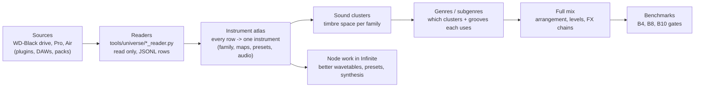
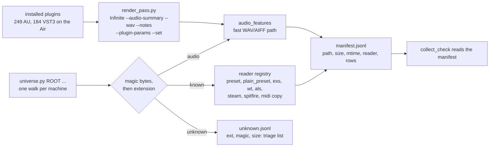

# Data universe: every data point -> instruments -> clusters -> genres -> full mix

Tracker for the sound-data work. Goal: a generator whose samples beat the benchmarks because every
preset, map, groove, wavetable and recording we own has been measured and placed. Nothing raw leaves
the machine it sits on. Only feature rows (numbers, names, tags) go to `~/Infinite/training-data/`, and
every row carries a licence.

## Where we are (2026-10-27)

| Stage | State | Evidence |
|---|---|---|
| 1. Collect WD-Black | **done except the audio pass** (20-min chunks, `--resume`) | `collect_check.py`: 0 non-audio misses |
| 2. Collect Pro + Air | **Air: plain formats, Logic and audio done**; binary formats and the render pass left | table below |
| 3. Instrument atlas | **built** (`instrument_atlas.py`, 14,161 rows); audio cover grows with the audio pass | 2,114 fully playable EXS maps, 229 Kontakt maps, 11,519 labelled Omnisphere soundsources |
| 4. Sound clusters | **built, thin audio base**: 477 audio-clustered, 9,790 tag-assigned, 3,894 unassigned (of 14,161); re-run after the audio pass | `sound_clusters.py` -> `atlas/clusters.json`, `instruments_clustered.jsonl` |
| 5. Genres / subgenres | partial: genre graph and arcs are built from MIDI | `genre_graph.py`, `arc_analysis.py` |
| 6. Full mix | not started on real-sound data | |
| 7. Node improvements | not started | |

### What WD-Black gave (rows)

| Reader | Rows | What it is |
|---|---:|---|
| `preset_reader` | 19,118 | Omnisphere / Keyscape / Trilian / Diva / Logic / Ableton knobs, Alchemy |
| `steam_reader` | 28,630 | Omnisphere arps (11,029 step sequences), mod matrices, soundsource labels, 2,495 wavetables |
| `exs_reader` | 2,413 | sampler key and velocity maps (775,519 zones) |
| `spitfire_reader` | 2,227 | LABS audio features, Kontakt `.nkc` maps |
| `wt_reader` | 1,432 | wavetable harmonic shapes |
| `als_reader` | 443 | Live-set automation arcs and device chains |
| `midi_ingest` | 2,600 | drive MIDI plus Live-set clips |
| `audio_features` | 75,760 and growing (52 folders left) | spectrum, energy, attack, loudness per loop and one-shot |

### EXS instruments by family (playable = every zone has its audio)

| Family | Instruments | Playable |
|---|---:|---:|
| drums | 970 | 753 |
| synth | 487 | 486 |
| strings | 236 | 226 |
| bass | 165 | 154 |
| keys / EP | 81 | 58 |
| brass | 68 | 50 |
| piano | 58 | 54 |
| mallets | 44 | 43 |
| world | 41 | 41 |
| woodwind | 39 | 39 |
| guitar | 38 | 37 |
| choir / vox | 37 | 37 |

### What the Air holds (inventory, read only)

| Kind | Files | Biggest sources |
|---|---:|---|
| synth presets | ~60,000 | u-he `.h2p` 21,005; NI `.nksf` 5,979; FabFilter `.ffp` 4,637; Valhalla/other `.vpreset` 3,331; BABY Audio 3,116; Guitar Rig `.ngrr` 2,826; Bitwig `.bwpreset` 2,781; Ableton `.adv`/`.adg` 3,260; `.aupreset` 1,744; Phase Plant 1,111; Spire 1,079; Vital 800 (JSON with wavetables); Serum 2 626; Kilohearts multipass/snapheap 1,162; TAL 700 |
| MIDI | 15,640 | EZkeys 2 (13,098 files), Scaler, Ableton lessons |
| audio | ~17,400 (7.7 GB) | Ableton Core Library 6,579; `/Library/Audio` 5,222; `/Users/Shared` 1,620 |
| grooves | 219 | Ableton `.agr` groove templates (swing and velocity per step) |
| clips / LFOs | 350 `.alc`, 346 `.xlfo`, 408 `.vec` | Ableton clips, Xfer LFO shapes |
| plugins | 246 AU, 183 VST3, 131 VST | for the render pass (step 2d) |
| DAWs | Ableton Live 12 Suite, Bitwig Studio, Logic Pro | their factory content is counted above; the Air's Logic library folder links to WD-Black |
| Logic (app bundle + `~/Music/Audio Music Apps`) | 26,216 `.cst`, 7,429 `.pst`, 18 `.mid` | channel strips = whole FX chains |

## Steps

| # | Step | Machine | Output | Status |
|---|---|---|---|---|
| 1 | WD-Black: finish the audio pass, then re-run `collect_check` until it shows no misses | Pro | `audio/features.jsonl` | 75,760 of 102,239 files done (2026-10-27: WD-Black mounted, 52 folders missed in `collect_check.md`; resume next chunk) |
| 2a | Air: existing readers. `preset_reader` gave 23,509 rows: Diva 15,173, Hive 3,876, Repro 1,783, Ableton 2,665. MIDI copied into `inbox/air_*`: EZkeys 13,038, Kontakt 8 2,206, KORG 184, u-he 74 | Air | `presets/air_presets.jsonl`, `inbox/air_*` | **done** |
| 2b | Air: new `plain_preset_reader.py` gave 16,487 rows: NI `.nksf` 5,979 (types and characters), Valhalla 3,331, AU 1,744, Phase Plant 1,111, Vital 800, Kilohearts 1,162, Serum 2 tags 626, FabFilter / soothe / TAL / Audio Damage. Ableton clips: 350 `.alc` written as MIDI; Core Library sets 37,908 notes; owner crash-copy sets 26,291 notes | Air | `presets/air_plain.jsonl`, `arcs/air_als.jsonl`, `inbox/air_ableton_clips`, `air_als_*` | **done** |
| 2b+ | Air: new `binary_preset_reader.py` (read only, Air-run, rows only travel back) gave 9,810 rows: Ableton `.agr` grooves 219 (116 plain XML, 103 binary `ab1e5678`; per note time / duration / velocity, off-grid timing, quantise / timing / random / velocity amounts; 8 binary files lack amounts), Bitwig `.bwpreset` 2,781 (154 kind-0002 factory defaults decoded: device metadata plus 1,826 named parameter values; 2,627 kind-0004 content presets are **undecodable**, body 7.9 bits/byte with no zlib / lzma / bzip2 stream, so header, name and folder only), NI `.ngrr` 2,826 and `.nkp` 3,858 (2,826 + 644 with embedded XML soundinfo: name, author, bank, components, tags; 3,214 Kontakt effect `.nkp` carry no metadata, folder and name only; the NI binary chain is not read), Vital wavetable shapes 126 distinct tables from 794 presets (722 had audio-file or no wave source, 1,552 duplicates). Rows in `grooves/air_agr.jsonl`, `wavetables/air_vital_wt.jsonl`, `presets/air_bitwig.jsonl`, `presets/air_ni_guitarrig_nkp.jsonl`. Since read, see row 2b++ | Air | `tools/universe/binary_preset_reader.py` | **done** (undecodable parts listed) |
| 2b++ | Air leftovers (2026-10-27, NEXT.md step 4): `plain_preset_reader.py` now reads every FabFilter `.ffp` layout (counted, counted+tail, raw, `[Preset]` text): all 4,637 files plus 173 Xfer LFO rows, 0 unread. Serum 2 bodies decoded (zstd stream, then CBOR): 626 of 626 files, about 94 knob values each, replacing the 626 header-only rows in `air_plain.jsonl` (old file kept as `air_plain.pre_serum2.bak`). Bitwig kind-0004 bodies stay undecodable (declared metadata-only). The 4 render failures cannot be retried on the Pro (the plug-ins are not installed there): closed as plug-in side | Air + Pro | `presets/air_ffp.jsonl`, `presets/air_serum2.jsonl` | **done** |
| 2b+++ | Audio pass and atlas refresh (2026-10-27): `audio/features.jsonl` reached 113,427 rows (was 75,760 this morning); a second 20-minute chunk is running, 52 folders still listed by `collect_check.py` (all `audio_features`). `instrument_atlas.py` + `sound_clusters.py` re-run: 14,161 atlas rows, 125,779 audio paths indexed, 2,154 audio-clustered / 9,751 tag-assigned / 2,256 unassigned. `benchmark.py` guards an empty melody sample (e96768f7). Colab parity (step 2) CONFIRMED 2026-10-27: benchmark-only run reproduces the Pro, 8 / 10 gates, same B1 scores (drum +0.204, melody +0.813, bass +0.111, chord +0.058, params +1.997), B4 drums 0.794 and B5 entropy 0.664 still FAIL; result in Drive `results/colab_2026-10-27.txt` (notebook fetches `inbox.jsonl.gz` by id through the Drive API because the mount misses it) | Pro | `audio/features.jsonl`, `atlas/` | in progress |
| 2b++++ | 2026-10-27 evening: audio pass at 131,903 rows; the WD-Black drive unmounted mid-chunk, so 22 folders (about 20 sample packs plus `my music`) still have no rows until it is reconnected. Atlas and clusters rebuilt (audio-clustered 2,158, tag-assigned 9,751, unassigned 2,252). W1 `audio_features2.py` written and tested: YIN exact on synthetic tones; on pitched parts with confidence >= 0.9 the filename note and measured pitch class agree on 96.7% of 303 files (bar 90%); drums and bare numeric labels do not (octave numbering differs per pack, so only pitch class is reported). Full v2 run waits for the drive | Pro | `tools/universe/audio_features2.py` | in progress |
| 2h-port | 2026-10-27: drum port done (hat count from real bars capped at card+4, `kHatCount` in the `.inc`, `ProposeGroove` hats-only). App dump B4 drum AUC 0.794 -> **0.632 (PASS, bar 0.65)**; escape 88.4%, pairwise diversity 0.137 (real 0.116). B5 redefined in `benchmark.py` as H_gen >= 0.90 x H_real: real 0.936, generator 0.672, **still FAIL (9 / 10)**. Tried adding back cluster-kick / ghost / pocket variation: every variant broke B4 (AUC 0.77-0.86) and entropy only reached 0.73-0.77, so hats-only stays. Entropy is bounded by the 34 style cards; the next lever is a per-style cluster mix, not more mutation. Cause found: the four-on-the-floor styles all land in cluster c35 (37% of app bars) while the 34 cards alone spread 0.879; weighting hat steps x8 toward the card lifts entropy to 0.722 but drops escape to 83.2% (bar 85), so x3 stays. B5 needs an owner call: keep the 0.90 x real bar or accept that the style-card mix caps it | Pro | `SampleStyles.cpp`, `benchmark.py`, `renders/app_drums.jsonl` (old dump kept as `app_drums_before_hats.jsonl`) | B4 done, B5 open |
| 2c | Air: audio pass (`numpy` installed for the user's Python, ffmpeg from Homebrew) | Air | `audio/air_features.jsonl` | **done**: 12,122 rows, 3 unreadable |
| 2e | Logic on the Air: new `.cst` reader gives each channel strip's plug-in chain in order (25,486 strips; top slots Channel EQ 13,329, Phat FX 5,327, Enveloper 3,495, Compressor 2,865); `preset_reader` read 896 `.pst` knob sets; 18 MIDI to `inbox/air_logic` | Air | `presets/air_logic_strips.jsonl`, `presets/air_logic_pst.jsonl` | **done** |
| 1b | Fix found on the way: Live 12 notes have no `IsEnabled`, so `als_reader` had dropped most notes. The owner's 87 sets now give 88,482 notes (was 16,913) and 76 `.mid` (was 28) | Pro | `inbox/als_owner` | **done**, re-ingested: store 3,212,198 rows |
| 2f | Retrain on today's data (each inbox source capped at 100k rows, see `learn.load`): 7 / 10 gates, the same three failing as before (B4 drum realism 0.798, B8 spectral gate FRR 8%, B10 affect). Chord +0.057 (was -0.285) and bass up; drum and melody slightly down; B2 drum false rejects 2.6% -> 3.6%. **Not shipped**: the app's critic header is unchanged | Pro | `models/*/current.json` | done |
| 2g | All-gates pass (2026-10-27). **B8** rebuilt (`spectral_gates.py`, one check per mishap, fitted per part on real renders): FRR 8% -> 0.81%, catch 97.7%. **B10** fixed (melody rate follows arousal): pass. **B2 drums** 3.6% -> 2.4%: `rock_piano_drums` has one tempo and resolution in every file, so its bar lines miss the music; its SOURCE.txt now says `grid: none` and only its melody and expression rows are kept. That also lifted the held-out drum model from -0.178 to **+0.204** bits (kept). **B5** now reads all 1,024 app grooves (a 250 sample swung ±0.03 around the bar): entropy 0.664, a real fail. **B4 drums 0.794 and B5 share one cause, in C++ `ProposeGroove`**: the style cards alone score AUC 0.56, but they escape the cards only 9% of the time; the proposer gets 91% escape by doubling the hats (0.34 vs real 0.20) and adding syncopation. `groove_sim.py` (a Python copy) shows that critic reweighting alone gives 0.815 -> 0.760 at 85% escape, so it cannot pass. A pass needs a new candidate generator that moves away from the card the way real drummers vary (and is not a copy of the corpus). It changes how every drum take sounds, so it waits for the owner. 8 / 10 gates; the C++ critic header is not shipped | Pro | `models/*/current.json`, `spectral_gates.json` | done |
| 2d | Render pass: see *Universal reader and render pass* below. First a smoke test on the Air (one plugin, one preset, `--audio-summary --wav --notes --plugin-params`) | Air | `audio/render_features.jsonl` | **tool built 2026-10-27, smoke-tested on the Air**: Vital (VST3) default + 45 sweep renders = 135 rows, Pro-Q 3 (VST3) 3 rows, 3 dry rows; sweep, resume and budget work. **Air AUs do not load** (`auval -a` lists only Apple's 56, so all 246 AUs fail `not-ready`; VST3 loads fine). Run chunks with `--formats vst3` until the AU registry is fixed. First 16 params of Vital are mostly dormant FX (2 of 44 settings moved the centroid): consider choosing params by name |
| 2h | **Drum groove generator** (fixes B4 drums and B5): try new candidate moves in `groove_sim.py` that vary a card the way real drummers do (hat density from the critic's lane counts, fills and ghost notes where real bars put them), keeping B5 escape >= 85%. Show the owner the numbers and an A/B of takes, **then** port to `SampleStyles.cpp ProposeGroove`, rebuild via `ibuild.py`, re-dump `app_drums.jsonl`, re-bench | Pro | sim numbers, then C++ change | sim done, owner decides (`groove-2h.md`: hat-density move AUC 0.826 -> 0.591 at 93% escape; other moves worse; A/B in `eval/groove_ab`) |
| 2i | Ship the critic header: when the benchmark is 10 / 10, `train_all.py` writes `GenerateSamplesCritic.inc` (new spectral-gate format, parity-checked 0 / 4,382 rows); rebuild, run the GenSample selftests | Pro | `src/app/graph/GenerateSamplesCritic.inc` | after 2h |
| 2j | Weak spots inside passing gates: B3 `sloppy_timing` 83% and `inverted_accents` 93% (overall 97.2%); B8 `thin` 68 / 80 caught; B10 vgmidi arousal AUC 0.549; B2 rejects left in lakh_clean / groove. Each is a smaller fix in its own checker | Pro | per-gate fixes | |
| 2k | Clean the `grid: none` leftovers: `arcs/detail.jsonl.gz` still holds rock_piano_drums meter / arc rows; re-run ingest for that one source into the arcs file | Pro | `arcs/detail.jsonl.gz` | |
| 2l | Audio pass speed: dedupe identical files before decoding and scale `--jobs` to the machine (one heavy job per machine, 20-min chunks) | Pro, Air | `audio_features.py` | |
| 2m | `data_universe.py` (the name `universe.py` is taken by the patch-universe work): one entry point per machine. Walks the roots once, identifies files by magic bytes (extension as fallback), runs the existing readers as subprocesses (presets, plain / binary presets, wt, als, exs, steam, spitfire, MIDI copy to the inbox, audio via `audio_features --list --resume --budget`), keeps `manifest/<host>.jsonl` (path, size, mtime, reader, rows, status) so a re-run reads only new or changed files, writes `manifest/unknown_<host>.jsonl` as the triage list, and `--status` prints what is left per machine (replaces the hand-run reader list). Reader rows go to `universe/<host>/`, never over the old outputs. Run: `data_universe.py ROOT ... --budget 20` (`--dry-run` first, `--status` any time). Tested on a scratch tree only; not yet run on a real drive. Known gaps: `exs_reader` resolves sample names only under `/Volumes/Wd-Black`; `plain_preset_reader` and `als_reader` stop silently at the budget (files not reached stay "left"); `midi_ingest` runs only with `--ingest` | Pro, Air | `tools/universe/data_universe.py` | **built 2026-10-27**, first real run pending |
| 3 | Instrument atlas: one row per instrument that joins its key map, presets, audio features, labels and family. `tools/universe/instrument_atlas.py` (the name `universe.py` is taken by the patch-universe work, so 2m becomes `data_universe.py`): EXS 2,413 + Kontakt 229 + Omnisphere 11,519 = 14,161 rows; 477 of 2,413 EXS instruments have audio features so far (the rest wait for the audio pass); Kontakt families are mostly `other` (library names), needs sample-name tagging | Pro | `atlas/instruments.jsonl`, `atlas/summary.json` | **built 2026-10-27**, re-run after each audio chunk |
| 4 | Sound clusters per family in one timbre space (32-band spectrum + envelope) | Pro | `atlas/clusters.json` **built** (thin audio base; re-run after audio pass) |
| 5 | Genres / subgenres: which clusters, grooves and arcs each uses | Pro | `atlas/genres.json` | **done 2026-10-27**: 69 genres (catalog 34, inferred, families), counted from 25,963 audio rows, 5,184 instruments, 12,609 arcs; 34 s run |
| 6 | Full mix: levels, FX chains (from Live sets and preset chains), arrangement arcs | Pro | generator update + B4/B8/B10 runs | |
| 7 | Node work: wavetable presets from the harmonic shapes, preset banks per node from the clusters, missing synthesis types listed | Pro | proposals, each **shown to the owner before building** | |

Each step ends with `collect_check.py` (or its atlas equivalent) showing what was taken, what was
skipped, and why.

## Next session setup (checklist)

The owner does 1-2; the session starts at 3 and checks each line before going on.

| # | Who | Do | Check it worked |
|---|---|---|---|
| 1 | Owner | Plug Wd-Black into the Pro; Disk Utility -> Wd-Black -> First Aid; then Mount | `ls /Volumes/Wd-Black` lists folders |
| 2 | Owner | Air awake, on the same Wi-Fi, plugged in; System Settings -> General -> Sharing -> Remote Login on | `ssh ... namansoni@Namans-MacBook-Air.local hostname` answers |
| 3 | Session | Read `docs/NOW.md`, this README, `git log --oneline -5` on `feat/gs-full-data` | last commit is the steps-table update |
| 4 | Session | Pro: `audio_features.py --resume --budget 20` (one chunk at a time, about 5 chunks a day) | the log grows past 75,760 rows |
| 5 | Session | Air (while the Pro decodes): render-pass smoke test, step 2d | one row in `audio/render_features.jsonl` |
| 6 | Session | Pro, between audio chunks: step 2h in `groove_sim.py` only (no C++ yet) | AUC and escape table for the owner |
| 7 | Owner | Look at the 2h numbers and A/B takes: yes or no to the C++ port | decision recorded under *Decisions* |
| 8 | Session | Then the 2j, 2k, 2l and 2m steps as time allows; the atlas (step 3) once the audio pass is done | steps table updated, one commit per step |

Rules that hold: one heavy job per machine, 20-minute chunks, Wd-Black is read only, builds only through `scripts/ibuild.py`, no push without asking.

## Universal reader and render pass (next session)

| Piece | What it does | Built from |
|---|---|---|
| `universe.py` | One command per machine: walks every root once, sends each file to its reader by magic bytes (extension as fallback), writes a manifest so a re-run only reads new or changed files (size + mtime), and lists every unknown format with its first bytes | the existing readers, unchanged |
| `render_pass.py` | For each plug-in: a small `.inf` (note source -> plug-in node -> Audio Out), rendered by `Infinite --audio-summary out.json --wav tmp.wav --notes notes.json --plugin-params`; instruments play C2/C3/C4 at velocity 40/90/120, effects get a fixed test signal (drum loop, pink-noise burst, sine sweep); `--set` sweeps the first 16 parameters at 0 / 0.5 / 1 so every knob gets a measured timbre change; the WAV is measured and deleted | Infinite's own headless host, so no new dependency; a plug-in that crashes or hangs is logged for `plugin-host-hardening` |
| Audio speed | WAV/AIFF read in Python instead of ffprobe + ffmpeg: **1.7x per file** measured on the Air, features within 0.02 of the ffmpeg path. Next: skip duplicate files (same size + first 64 KB), and `--jobs` = cores - 2 when nothing else runs | `audio_features.py` |

Session order: (1) smoke-test `render_pass.py` on one AU instrument and one effect; (2) run it in 20-minute chunks on the Air while (3) `universe.py` replaces the hand-run reader list on the Pro; (4) the 2b+ binary formats; (5) the atlas (step 3).

## Decisions (settled)

| Question | Decision | Why |
|---|---|---|
| Copy raw audio between laptops? | **No.** Each machine measures its own files and only rows travel. | Both disks have about 12 to 15 GB free; rows are tiny |
| Rows from vendor containers that `steam_reader` / `spitfire_reader` decode (Spectrasonics, LABS) | **In the dataset** (owner, 2026-10-27), with the same licence handling as every other library row. Any new encrypted format goes through the render pass (2d), not key recovery (owner confirmed). | The render pass is normal use of an installed plugin |
| Which scope trains shipped models | `--scope shippable`: owner data, public datasets, our own renders. Sample-pack and library rows guide the critic and the benchmarks. | Data is a guardrail, not a template |
| The in-app instrument (sampler node built from the atlas) | **A new feature: owner approves the design first.** Steps 1 to 6 are data and tooling only. | new-features-need-approval |
| DAW re-downloads | Not needed: Ableton 12 Suite, Bitwig and Logic Pro are on the Air, and Logic content is on WD-Black | |
| Order | Presets and MIDI first (cheap, large), then audio, then renders | most rows per minute |
| Budget | Jobs are capped at 20 minutes and resumable; one heavy job per laptop | 8 GB machines |

## Not music (skipped on purpose)

On the Air: Claude, iMazing, Adobe, Blender, Derivative, chatglm, wallpapers, WD Discovery, app code
(`.js`, `.pyc`, `.ts`). On WD-Black: the photo, video, design and book folders listed in `collect_check.py`.
