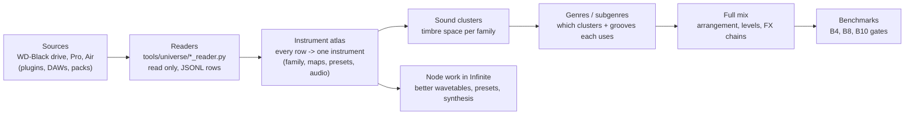
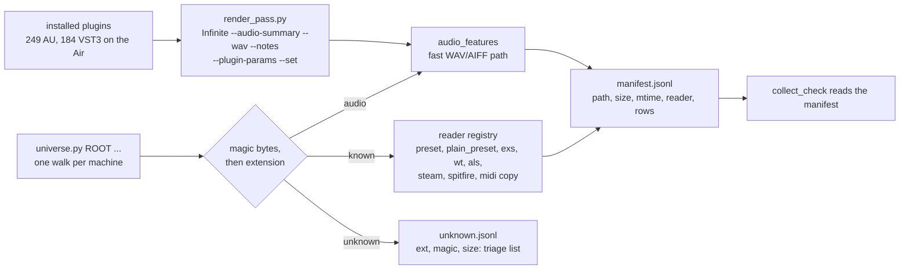

# Data universe: every data point -> instruments -> clusters -> genres -> full mix

Tracker for the sound-data work. Goal: a generator whose samples beat the benchmarks because every
preset, map, groove, wavetable and recording we own has been measured and placed. Nothing raw leaves
the machine it sits on. Only feature rows (numbers, names, tags) go to `~/Infinite/training-data/`, and
every row carries a licence.

## Where we are (2026-10-27)

| Stage | State | Evidence |
|---|---|---|
| 1. Collect WD-Black | **done except the audio pass** (20-min chunks, `--resume`) | `collect_check.py`: 0 non-audio misses |
| 2. Collect Pro + Air | **Air: plain formats, Logic and audio done**; binary formats and the render pass left | table below |
| 3. Instrument atlas | **data ready, builder not written** | 2,114 fully playable EXS maps, 229 Kontakt maps, 11,519 labelled Omnisphere soundsources |
| 4. Sound clusters | not started (drums only: `mix.py`) | |
| 5. Genres / subgenres | partial: genre graph and arcs are built from MIDI | `genre_graph.py`, `arc_analysis.py` |
| 6. Full mix | not started on real-sound data | |
| 7. Node improvements | not started | |

### What WD-Black gave (rows)

| Reader | Rows | What it is |
|---|---:|---|
| `preset_reader` | 19,118 | Omnisphere / Keyscape / Trilian / Diva / Logic / Ableton knobs, Alchemy |
| `steam_reader` | 28,630 | Omnisphere arps (11,029 step sequences), mod matrices, soundsource labels, 2,495 wavetables |
| `exs_reader` | 2,413 | sampler key and velocity maps (775,519 zones) |
| `spitfire_reader` | 2,227 | LABS audio features, Kontakt `.nkc` maps |
| `wt_reader` | 1,432 | wavetable harmonic shapes |
| `als_reader` | 443 | Live-set automation arcs and device chains |
| `midi_ingest` | 2,600 | drive MIDI plus Live-set clips |
| `audio_features` | 26,595 and growing | spectrum, energy, attack, loudness per loop and one-shot |

### EXS instruments by family (playable = every zone has its audio)

| Family | Instruments | Playable |
|---|---:|---:|
| drums | 970 | 753 |
| synth | 487 | 486 |
| strings | 236 | 226 |
| bass | 165 | 154 |
| keys / EP | 81 | 58 |
| brass | 68 | 50 |
| piano | 58 | 54 |
| mallets | 44 | 43 |
| world | 41 | 41 |
| woodwind | 39 | 39 |
| guitar | 38 | 37 |
| choir / vox | 37 | 37 |

### What the Air holds (inventory, read only)

| Kind | Files | Biggest sources |
|---|---:|---|
| synth presets | ~60,000 | u-he `.h2p` 21,005; NI `.nksf` 5,979; FabFilter `.ffp` 4,637; Valhalla/other `.vpreset` 3,331; BABY Audio 3,116; Guitar Rig `.ngrr` 2,826; Bitwig `.bwpreset` 2,781; Ableton `.adv`/`.adg` 3,260; `.aupreset` 1,744; Phase Plant 1,111; Spire 1,079; Vital 800 (JSON with wavetables); Serum 2 626; Kilohearts multipass/snapheap 1,162; TAL 700 |
| MIDI | 15,640 | EZkeys 2 (13,098 files), Scaler, Ableton lessons |
| audio | ~17,400 (7.7 GB) | Ableton Core Library 6,579; `/Library/Audio` 5,222; `/Users/Shared` 1,620 |
| grooves | 219 | Ableton `.agr` groove templates (swing and velocity per step) |
| clips / LFOs | 350 `.alc`, 346 `.xlfo`, 408 `.vec` | Ableton clips, Xfer LFO shapes |
| plugins | 246 AU, 183 VST3, 131 VST | for the render pass (step 2d) |
| DAWs | Ableton Live 12 Suite, Bitwig Studio, Logic Pro | their factory content is counted above; the Air's Logic library folder links to WD-Black |
| Logic (app bundle + `~/Music/Audio Music Apps`) | 26,216 `.cst`, 7,429 `.pst`, 18 `.mid` | channel strips = whole FX chains |

## Steps

| # | Step | Machine | Output | Status |
|---|---|---|---|---|
| 1 | WD-Black: finish the audio pass, then re-run `collect_check` until it shows no misses | Pro | `audio/features.jsonl` | running: 102,239 files planned, about 12 chunks of 20 min |
| 2a | Air: existing readers. `preset_reader` gave 23,509 rows: Diva 15,173, Hive 3,876, Repro 1,783, Ableton 2,665. MIDI copied into `inbox/air_*`: EZkeys 13,038, Kontakt 8 2,206, KORG 184, u-he 74 | Air | `presets/air_presets.jsonl`, `inbox/air_*` | **done** |
| 2b | Air: new `plain_preset_reader.py` gave 16,487 rows: NI `.nksf` 5,979 (types and characters), Valhalla 3,331, AU 1,744, Phase Plant 1,111, Vital 800, Kilohearts 1,162, Serum 2 tags 626, FabFilter / soothe / TAL / Audio Damage. Ableton clips: 350 `.alc` written as MIDI; Core Library sets 37,908 notes; owner crash-copy sets 26,291 notes | Air | `presets/air_plain.jsonl`, `arcs/air_als.jsonl`, `inbox/air_ableton_clips`, `air_als_*` | **done** |
| 2b+ | Still unread on the Air: Bitwig `.bwpreset` (binary), NI `.ngrr` / `.nkp` (zlib), Ableton `.agr` grooves (binary), 3,103 `.ffp` not in `FT3i` form, Serum 2 knob bodies (zstd), Vital wavetable shapes | | | next |
| 2c | Air: audio pass (`numpy` installed for the user's Python, ffmpeg from Homebrew) | Air | `audio/air_features.jsonl` | **done**: 12,122 rows, 3 unreadable |
| 2e | Logic on the Air: new `.cst` reader gives each channel strip's plug-in chain in order (25,486 strips; top slots Channel EQ 13,329, Phat FX 5,327, Enveloper 3,495, Compressor 2,865); `preset_reader` read 896 `.pst` knob sets; 18 MIDI to `inbox/air_logic` | Air | `presets/air_logic_strips.jsonl`, `presets/air_logic_pst.jsonl` | **done** |
| 1b | Fix found on the way: Live 12 notes have no `IsEnabled`, so `als_reader` had dropped most notes. The owner's 87 sets now give 88,482 notes (was 16,913) and 76 `.mid` (was 28) | Pro | `inbox/als_owner` | **done**, re-ingested: store 3,212,198 rows |
| 2f | Retrain on today's data (each inbox source capped at 100k rows, see `learn.load`): 7 / 10 gates, the same three failing as before (B4 drum realism 0.798, B8 spectral gate FRR 8%, B10 affect). Chord +0.057 (was -0.285) and bass up; drum and melody slightly down; B2 drum false rejects 2.6% -> 3.6%. **Not shipped**: the app's critic header is unchanged | Pro | `models/*/current.json` | done |
| 2g | All-gates pass (2026-10-27). **B8** rebuilt (`spectral_gates.py`, one check per mishap, fitted per part on real renders): FRR 8% -> 0.81%, catch 97.7%. **B10** fixed (melody rate follows arousal): pass. **B2 drums** 3.6% -> 2.4%: `rock_piano_drums` has one tempo and resolution in every file, so its bar lines miss the music; its SOURCE.txt now says `grid: none` and only its melody and expression rows are kept. That also lifted the held-out drum model from -0.178 to **+0.204** bits (kept). **B5** now reads all 1,024 app grooves (a 250 sample swung ±0.03 around the bar): entropy 0.664, a real fail. **B4 drums 0.794 and B5 share one cause, in C++ `ProposeGroove`**: the style cards alone score AUC 0.56, but they escape the cards only 9% of the time; the proposer gets 91% escape by doubling the hats (0.34 vs real 0.20) and adding syncopation. `groove_sim.py` (a Python copy) shows that critic reweighting alone gives 0.815 -> 0.760 at 85% escape, so it cannot pass. A pass needs a new candidate generator that moves away from the card the way real drummers vary (and is not a copy of the corpus). It changes how every drum take sounds, so it waits for the owner. 8 / 10 gates; the C++ critic header is not shipped | Pro | `models/*/current.json`, `spectral_gates.json` | done |
| 2d | Render pass: see *Universal reader and render pass* below | Air | `audio/render_features.jsonl` | planned, owner approved the approach |
| 3 | Instrument atlas: one row per instrument that joins its key map, presets, audio features, labels and family | Pro | `atlas/instruments.jsonl` | |
| 4 | Sound clusters per family in one timbre space (32-band spectrum + envelope) | Pro | `atlas/clusters.json` | |
| 5 | Genres / subgenres: which clusters, grooves and arcs each uses | Pro | `atlas/genres.json` | |
| 6 | Full mix: levels, FX chains (from Live sets and preset chains), arrangement arcs | Pro | generator update + B4/B8/B10 runs | |
| 7 | Node work: wavetable presets from the harmonic shapes, preset banks per node from the clusters, missing synthesis types listed | Pro | proposals, each **shown to the owner before building** | |

Each step ends with `collect_check.py` (or its atlas equivalent) showing what was taken, what was
skipped, and why.

## Universal reader and render pass (next session)

| Piece | What it does | Built from |
|---|---|---|
| `universe.py` | One command per machine: walks every root once, sends each file to its reader by magic bytes (extension as fallback), writes a manifest so a re-run only reads new or changed files (size + mtime), and lists every unknown format with its first bytes | the existing readers, unchanged |
| `render_pass.py` | For each plug-in: a small `.inf` (note source -> plug-in node -> Audio Out), rendered by `Infinite --audio-summary out.json --wav tmp.wav --notes notes.json --plugin-params`; instruments play C2/C3/C4 at velocity 40/90/120, effects get a fixed test signal (drum loop, pink-noise burst, sine sweep); `--set` sweeps the first 16 parameters at 0 / 0.5 / 1 so every knob gets a measured timbre change; the WAV is measured and deleted | Infinite's own headless host, so no new dependency; a plug-in that crashes or hangs is logged for `plugin-host-hardening` |
| Audio speed | WAV/AIFF read in Python instead of ffprobe + ffmpeg: **1.7x per file** measured on the Air, features within 0.02 of the ffmpeg path. Next: skip duplicate files (same size + first 64 KB), and `--jobs` = cores - 2 when nothing else runs | `audio_features.py` |

Session order: (1) smoke-test `render_pass.py` on one AU instrument and one effect; (2) run it in 20-minute chunks on the Air while (3) `universe.py` replaces the hand-run reader list on the Pro; (4) the 2b+ binary formats; (5) the atlas (step 3).

## Decisions (settled)

| Question | Decision | Why |
|---|---|---|
| Copy raw audio between laptops? | **No.** Each machine measures its own files and only rows travel. | Both disks have about 12 to 15 GB free; rows are tiny |
| Rows from vendor containers that `steam_reader` / `spitfire_reader` decode (Spectrasonics, LABS) | **In the dataset** (owner, 2026-10-27), with the same licence handling as every other library row. Any new encrypted format goes through the render pass (2d), not key recovery (owner confirmed). | The render pass is normal use of an installed plugin |
| Which scope trains shipped models | `--scope shippable`: owner data, public datasets, our own renders. Sample-pack and library rows guide the critic and the benchmarks. | Data is a guardrail, not a template |
| The in-app instrument (sampler node built from the atlas) | **A new feature: owner approves the design first.** Steps 1 to 6 are data and tooling only. | new-features-need-approval |
| DAW re-downloads | Not needed: Ableton 12 Suite, Bitwig and Logic Pro are on the Air, and Logic content is on WD-Black | |
| Order | Presets and MIDI first (cheap, large), then audio, then renders | most rows per minute |
| Budget | Jobs are capped at 20 minutes and resumable; one heavy job per laptop | 8 GB machines |

## Not music (skipped on purpose)

On the Air: Claude, iMazing, Adobe, Blender, Derivative, chatglm, wallpapers, WD Discovery, app code
(`.js`, `.pyc`, `.ts`). On WD-Black: the photo, video, design and book folders listed in `collect_check.py`.
